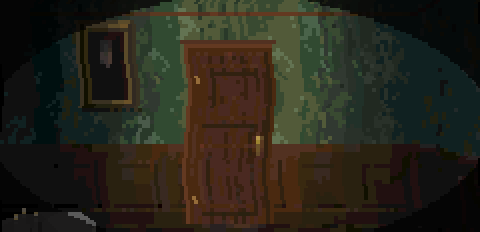
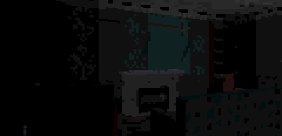
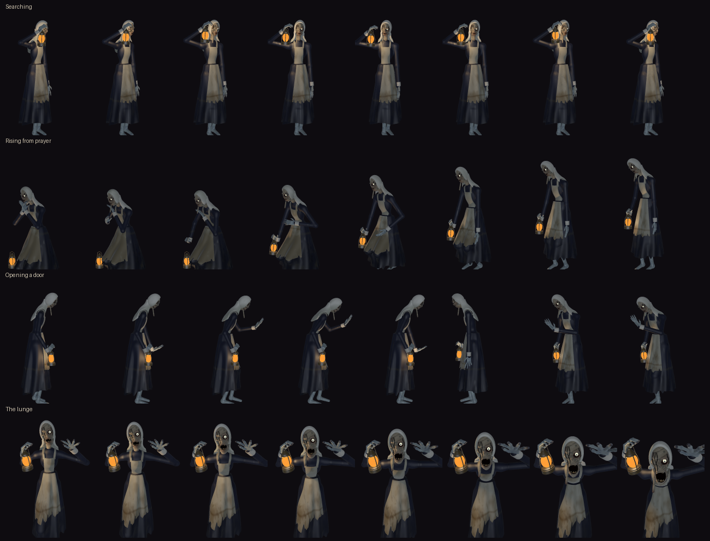

<div align="center">


# Hollowmere

**A first-person survival-horror game for the Game Boy Advance,<br>and the 3D engine it runs on, free to build your own games with.**

Textured 3D at full resolution on a 16.78 MHz handheld from 2001. Written in C and ARM assembly, its whole world generated from code, MIT licensed.

[**Play the game**](https://github.com/PowerBeef/hollowmere/releases/latest) · [**Build your own**](#build-your-own-game) · [How the engine works](docs/ENGINE.md) · [Making a game](docs/MAKING_A_GAME.md) · [Tools & tests](docs/TOOLS.md) · [Changelog](CHANGELOG.md)


</div>

<table>
<tr>
<td width="50%" valign="top">

**If you want to play**

A haunted sanatorium, a flashlight, and something that walks the corridors with a lantern. Four chapters, one ROM, any GBA emulator.

[Meet the game ↓](#the-game)

</td>
<td width="50%" valign="top">

**If you want to build**

A complete first-person engine with its content tools and test suite. The example game in the repository is one 180-line C file.

[Meet the engine ↓](#the-engine)

</td>
</tr>
</table>

---

## The game

*Autumn, 1958.* Your brother Thomas was sent to Hollowmere, a private sanatorium on an island in a cold, black lake, for "the water cure". His letters grew shorter, then stopped. One night you row across the lake alone. The house is dark — all but one window, high up under the roof.

Explore the manor floor by floor and piece together what happened from the notes left behind. You have no weapon. You have a flashlight, and you are not alone.

### The Night Sister

She walks the house at night with a lantern, and she is drawn to light and noise.

- **She sees.** Your flashlight shows you the way and shows her where you are.
- **She hears.** Running is fast and loud, and she hears it from five tiles away.
- **She remembers.** Lose her and she goes to where she last saw you, and searches the room.
- **She opens doors.** A closed door buys you a moment. No more.
- **She cannot leave a fire burning.** Light a hearth and she will come to it, kneel, and stay until it is cold.

<table>
<tr>
<td></td>
<td></td>
</tr>
</table>

Hide in a wardrobe and watch her through the slats. Hold still in the dark. Keep your light low, and never let her count you.

### What is in it

- **Four chapters**: the house, the cellars, the wards upstairs and the attic chapel
- **A light to ration**: the flashlight's battery runs down, and spare batteries have to be found
- **Fires to light**: a box of matches makes a dark room a warm one, and makes bait. She comes to every fire, so one lit at the far end of the house buys you this end
- **A map that fills in** as you explore, and a journal of every note you find
- **Checkpoints** saved to the cartridge, in a way that survives switching off mid-save
- **A world made from code**: every texture, model, sound and note of music is generated, none drawn or recorded

<table>
<tr>
<td></td>
<td></td>
</tr>
<tr>
<td></td>
<td></td>
</tr>
<tr>
<td></td>
<td></td>
</tr>
<tr>
<td></td>
<td></td>
</tr>
<tr>
<td></td>
<td></td>
</tr>
</table>

### Play it

1. Download the zip from the [latest release](https://github.com/PowerBeef/hollowmere/releases/latest).
2. Open the `Hollowmere.gba` inside it in a GBA emulator. [mGBA](https://mgba.io) is the one it is tested in.
3. Turn the lights off and put headphones on.

It is a real cartridge image with battery saves (SRAM), so a flash cartridge should run it on a console too. That has not been tried yet: if you do, [say how it went](https://github.com/PowerBeef/hollowmere/issues).

| Button | Action |
|---|---|
| D-pad | Walk / turn |
| L / R | Step sideways |
| A | Open, take, read, hide |
| B (hold) | Run — she hears it |
| SELECT | Flashlight on / off (hold: map) |
| START | Pause, map, journal, options |

An alternative layout (B for the light, R to run, SELECT for the map) is in the options.

---

## The engine

Everything above is drawn by the Hollowmere Engine: a software renderer for the GBA's 240×160 bitmap mode, with the systems a first-person game needs around it. It is separate from the game, MIT licensed, and comes with the tools that make its content and the tests that keep it honest.

**What you get**

- **Buildings, not mazes.** Walls sit on the edges of a grid, so rooms share thin walls the way real ones do, with doorways, arches and windows you can see through, three deep. Rooms are two tiles tall, with textured floors and ceilings.
- **Real 3D objects.** Furniture, props and door leaves are textured polygon meshes, depth-sorted and clipped against the walls. Doors swing on their hinges.
- **Light as a game mechanic.** A flashlight cone, a light level per cell, and lights that flicker, pulse, burn like a fire and go out, switched by scripts or by the game's own rules.
- **Sound in space.** A stereo software mixer with positional 3D sound and a music sequencer.
- **Scripted events.** A small bytecode machine runs eight scripts at once: doors, lights, sounds, messages, the enemy, cutscenes.
- **The rest of a game.** Collision, line of sight, locks and keys, triggers and pickups, a HUD, map data, and saves that survive a power cut.
- **A steady frame.** 20 frames per second in all but the heaviest views, held by a governor that measures every frame and trades far detail for speed before one can be missed.

### Build your own game


A game is a folder: its C code, its content as Python, and four lines of `game.mk`. It includes one header of the engine, [`engine/src/game_api.h`](engine/src/game_api.h), and defines nine hooks (how to draw a frame, what a script's "enemy" operation means, whether a save is valid...).

[`examples/minimal`](examples/minimal) is the smallest complete one: a lit room, a closet behind a door, a key. One 180-line C file and nine short content modules.

```sh
make GAME=examples/minimal assets all      # -> build/minimal/minimal.gba
```

```c
int main(void) {
    engine_init();
    load_level(0);
    for (;;) {
        engine_frame_start();
        for (int n = engine_ticks(); n > 0; n--) update();   // input, movement, scripts
        engine_frame();                                      // draw, govern detail, show
    }
}
```

Copy the example, change the room, and you have a game. [docs/MAKING_A_GAME.md](docs/MAKING_A_GAME.md) covers the rest: floor plans, models, every script operation, and the limits. Hollowmere itself, in [`game/`](game), is the full-size example, and it is MIT too: take whatever is useful.

### Content is code

There is no editor and no binary asset to lose. A level is a floor plan typed as text, a table is a few boxes, a wallpaper is a function, a door creak is a synthesizer patch, and an event is a short script:

- **`make assets` builds all of it**, and a cache rebuilds only what changed.
- **Mistakes are caught at build time.** A 41st door, a 129th vertex, a line of text too long for the screen: the tools refuse each in one line that names the level, event or model. The limits live in one file, [`engine/src/limits.h`](engine/src/limits.h), which the C code, the tools and the linker all read.
- **Builds are reproducible.** The same sources give the same ROM, byte for byte; each release is rebuilt from a clean checkout and compared with its recorded hash before it is published.



*Characters can be pre-rendered. The Night Sister is a 3D rig posed in Python and drawn by a small ray marcher in the repository: 360 frames, from 8 angles, at 4 sizes.*

### How it gets 3D out of a GBA

The GBA has a 16.78 MHz ARM7, no 3D hardware, no divide instruction and 32 KB of fast memory. Everything that runs per pixel is hand-written ARM code living in those 32 KB.

**Walls and floors**
- A thin-wall raycaster at full horizontal resolution: 240 columns, drawn in pairs by assembly fillers
- Wall textures stored in seven layouts (column order, pairs, four quad alignments), so one memory read fetches two or four texels, with four mip levels each
- An occluder pre-pass, so walls hidden behind large furniture are never drawn

**Meshes**
- Projected with reciprocal tables instead of divisions, back-face culled, sorted, and clipped against walls and lintels
- Three fill paths: wall-like faces as perspective-correct trapezoids, general convex polygons through per-column edge buffers, wide faces as exact rows
- Level of detail per face, and simpler models far away

**Light and effects**
- 32 light levels through colormaps: a flashlight cone, a light grid per cell, and lights that scripts switch and flicker
- The GBA's own hardware for the rest: affine head-bob, shake, roll and zoom, per-scanline wave distortion, window vignettes and cinema bars, fades

**Tricks worth stealing**
- Renderer tables live in the video memory the letterbox hides: the off-screen rows of both frame buffers hold the depth buffer, colormaps and projection scratch, read as fast as internal RAM
- The cartridge is spent on speed: about 10 MB of the 17 MB ROM is texture data arranged in advance for the fillers
- A fixed budget of 842,688 cycles per frame, measured on every frame, interrupts included. Work that would cost several frames (light tables, text, path searches) is spread over ticks

The full tour of the runtime is in [docs/ENGINE.md](docs/ENGINE.md).

### It comes with its tests

A headless [mGBA](https://mgba.io) harness scripts input, reads and writes memory by symbol, takes screenshots and fails on any bad memory access. On it, `make check` runs:

| | |
|---|---|
| Playthrough | the whole game from power-on to the ending, asserting progress at every stage, also with a death in every chapter |
| Regression tests | 46, one for every bug fixed and behaviour added |
| View sweep | every place the player can stand, 20,280 views at three detail levels: no pixel left undrawn |
| Hostile saves | 43 save files (blank, random, cut off mid-write, valid checksum with nonsense inside): each must end in a running game |
| Content limits | 48 kinds of bad content, each refused by the asset tools in one line |
| Stack, frame rate, boot | stack headroom from a canary painted at boot, frame rate at benchmark views, the release ROM through a minute of random input |

A new game gets the same harness and every check that applies to it. Details in [docs/TOOLS.md](docs/TOOLS.md).

### What to know before you build on it

- **Not every view holds 20 fps.** Of 3,381 places and headings sampled in Hollowmere, 70 fall below 19.5 fps and 18 of those stay at 15: close views of the hall staircase and the chapel's pews, where furniture covers the screen several times over. Three quarters of all views run at full detail. Furniture is the expensive thing to draw: a fireplace filling the view costs several detail levels.
- **It has only been run in an emulator.** Every timing is from mGBA 0.10.2, which may read video memory faster than a console does.
- **It has limits**: 40 doors and 160 props a level, 128 vertices a model, 8 scripts at once. They are all in [`limits.h`](engine/src/limits.h), and the tools tell you when you reach one.

---

## Building

You need an ARM GCC toolchain and Python 3 with NumPy, Pillow and SciPy:

```sh
sudo apt install gcc-arm-none-eabi libnewlib-arm-none-eabi     # Debian/Ubuntu
pip install -r requirements.txt
make assets   # generate gen/ from game/content (about two minutes the first time, cached after)
make          # build hollowmere.gba
```

With the versions pinned in `requirements.txt` and listed in [docs/TOOLS.md](docs/TOOLS.md), a clean build gives the released ROM byte for byte: `sha256sum -c game/release.sha256` checks it.

To run the tests as well, install `libmgba-dev`:

```sh
make check                                          # everything; about an hour (the full view sweep)
make test-rom harness && python3 engine/tools/check.py --quick      # ten minutes: the sweep on every 12th view
```

Re-rendering the Night Sister (`python3 game/content/sister/make.py`) needs Numba (`requirements-optional.txt`).

## Repository layout

```
engine/
  src/        the runtime: renderer, 3D objects, lighting, audio, effects, world, scripting VM, HUD, saves,
              the frame loop; game_api.h is its whole interface to a game, limits.h its limits
  tools/      the toolchain: asset compiler, level/mesh/script compilers, checks, benchmarks
  harness/    headless mGBA test runner
game/         Hollowmere
  src/        its code: play loop, game rules, the player, the Night Sister, the map screen, menus
  content/    its content as code: levels, models, textures, sprites, sounds, music, story
  assets/     pre-rendered frames of the Night Sister (slow to regenerate), the title font
  tests/      the playthrough, regression tests, hostile saves, benchmark views
examples/
  minimal/    the smallest game the engine builds: one C file, a room, a door, a key
docs/         architecture, content and tooling guides
CHANGELOG.md  what changed between releases
```

## License

Everything in this repository is released under the [MIT License](LICENSE): the engine, the toolchain, the documentation, and the game itself — Hollowmere's code, levels, story, models, textures, sounds, music and characters, and the screenshots in `docs/media/`. Use the engine for your own GBA games, and take whatever is useful from the game.

The title screen is set in TeX Gyre Bonum, which ships in `game/assets/fonts` under the GUST Font License.

## Credits

Hollowmere and the Hollowmere Engine were directed by [PowerBeef](https://github.com/PowerBeef) and designed, programmed and generated by Claude (Anthropic). The test harness uses [mGBA](https://mgba.io) by endrift and contributors.
