<div align="center">

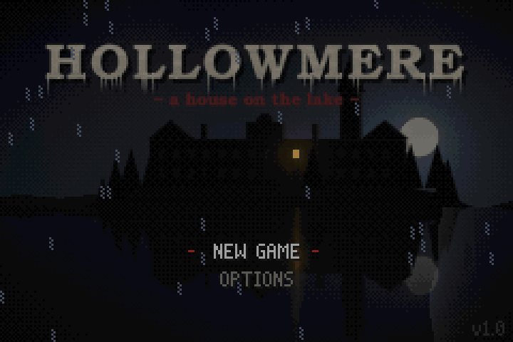

# Hollowmere Engine

**A first-person 3D engine for the Game Boy Advance, and _Hollowmere_, the survival-horror game built on it.**

Full-resolution textured 3D at 20 fps on a 16.78 MHz ARM7, in C and hand-written ARM assembly.

[**Download Hollowmere v1.1**](https://github.com/PowerBeef/hollowmere/releases/latest) · [What's new](CHANGELOG.md) · [Engine architecture](docs/ENGINE.md) · [Making a game](docs/MAKING_A_GAME.md) · [Toolchain & testing](docs/TOOLS.md)

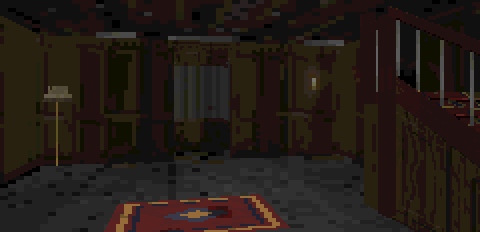

</div>

---

## Contents

- [Hollowmere, the game](#hollowmere-the-game): what it is, how to play it
- [What's new in v1.1](#whats-new-in-v11)
- [The engine](#the-engine): what it does and how
- [Make your own game](#make-your-own-game): the interface and a 180-line example
- [Tested, and plain about its limits](#tested-and-plain-about-its-limits)
- [Building](#building) · [Repository layout](#repository-layout) · [License](#license) · [Credits](#credits)

---

## Hollowmere, the game

*Autumn, 1958.* Your brother Thomas was sent to Hollowmere, a private sanatorium on an island in a cold, black lake, for "the water cure". His letters grew shorter, then stopped. One night you row across the lake alone. The house is dark — all but one window, high up under the roof.

Explore the manor floor by floor, piece together what happened from the notes left behind, and keep your light low: **the Night Sister** is drawn to light and noise. Hide in wardrobes, hold still in the dark, and never let her count you.

- Four chapters: the house, the cellars, the wards upstairs and the attic chapel
- An enemy with sight, hearing and memory who patrols, investigates, searches and hunts, finding her way through the house (and its doors) by flow-field pathfinding
- Flashlight with a battery to manage, running that she can hear, hiding places
- Resident Evil-style map screen, journal of collected notes, checkpoints saved to the cartridge
- Every texture, model, sprite, sound and note of music generated procedurally from code

<table>
<tr>
<td>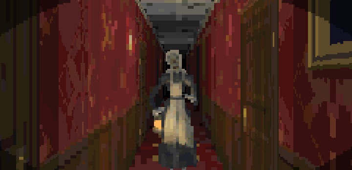</td>
<td>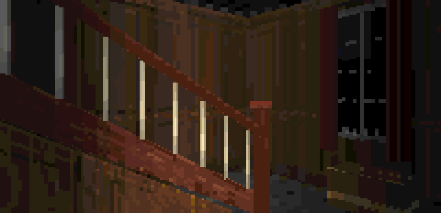</td>
</tr>
<tr>
<td>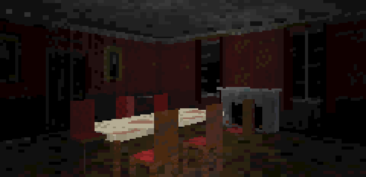</td>
<td>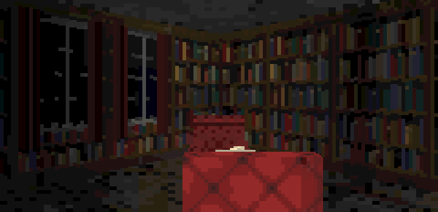</td>
</tr>
<tr>
<td>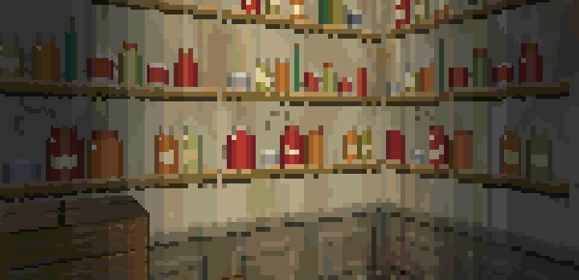</td>
<td>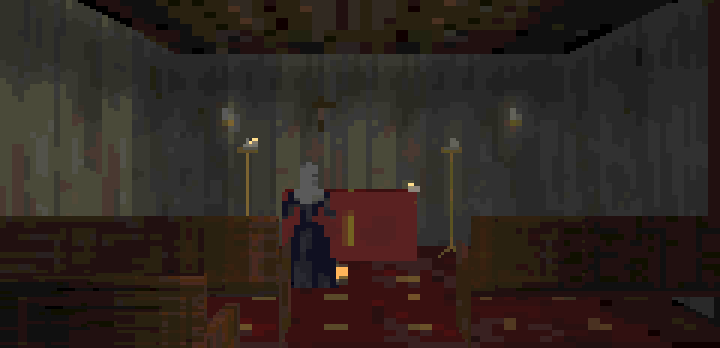</td>
</tr>
<tr>
<td>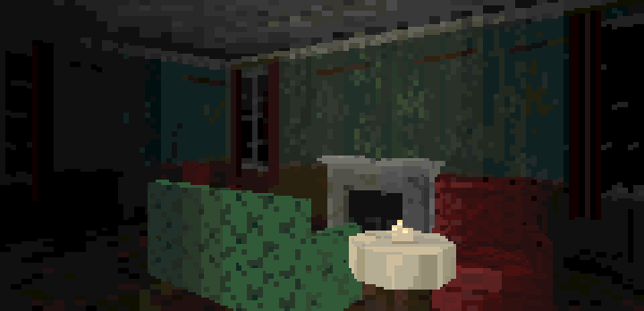</td>
<td>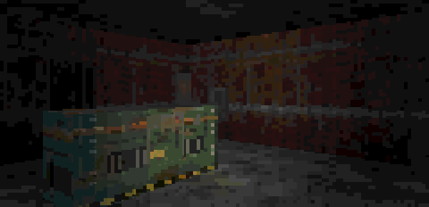</td>
</tr>
<tr>
<td>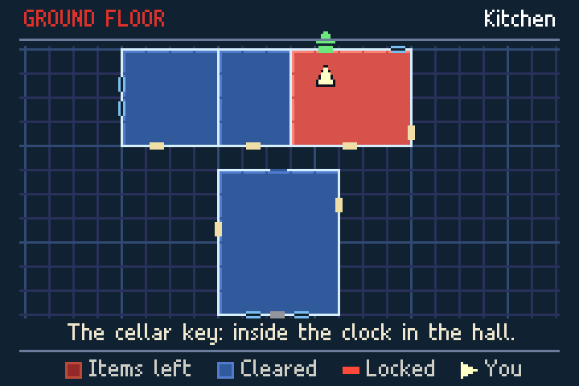</td>
<td>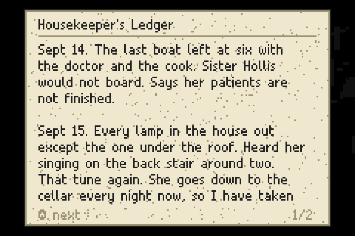</td>
</tr>
</table>

### Play it

Download `Hollowmere.gba` from the [latest release](https://github.com/PowerBeef/hollowmere/releases/latest) (or `Hollowmere-v1.1.zip`, which holds the same file) and run it in any accurate GBA emulator ([mGBA](https://mgba.io) recommended) or on hardware with a flash cartridge (it saves to SRAM). Best played in the dark, with headphones.

| Button | Action |
|---|---|
| D-pad | Walk / turn |
| L / R | Step sideways |
| A | Open, take, read, hide |
| B (hold) | Run — she hears it |
| SELECT | Flashlight on / off (hold: map) |
| START | Pause, map, journal, options |

An alternative layout (B for the light, R to run, SELECT for the map) is in the options.

A save from v1.0 still works: the game continues at the start of the chapter it had reached, with the notes found so far.

---

## What's new in v1.1

v1.1 is the result of a full audit of v1.0 and the repair of everything it found: 59 findings, from a chapter that could not be finished after a death to a test suite that could not fail. The whole list is in the [changelog](CHANGELOG.md). In short:

**The game**
- Chapter IV can be finished after dying in it, and a checkpoint now keeps the scripts that were running when it was taken
- Running makes noise, as the controls screen always said
- Furniture no longer vanishes or leaves stale pixels at some angles: 20,368 views checked, none with an undrawn pixel (v1.0: 583)
- Saves survive a power cut mid-write (two alternating slots) and a corrupt save can no longer hang the game
- A dozen smaller fixes: the wardrobe view leaking into menus, a sign cut off mid-sentence, flashes of wrong colours on four transitions, hitches when the flashlight is switched or a subtitle appears

**The engine**
- It stands apart from the game: one header is the whole interface, and a [second, tiny game](examples/minimal) builds on it
- One table of limits, enforced: the asset tools refuse content the engine cannot handle, by name
- A test suite that can fail, and does on v1.0: 36 of its 38 regression tests
- The whole repository is now under the MIT licence, the game included

---

## The engine

The Hollowmere Engine renders a first-person 3D world into the GBA's 240×160 8-bit bitmap mode, entirely in software, at 20 frames per second in all but its heaviest views. Everything that runs per pixel is ARM code in the 32 KB of fast internal RAM.

**World rendering**
- Thin-wall raycaster: walls sit on the edges of a grid, so rooms share walls the way real buildings do, with doorways, arches, windows and lintels you can see through, three deep
- Full horizontal resolution (240 columns), with columns drawn in pairs by hand-written assembly fillers
- Two-tile-tall rooms, textured floors and ceilings with per-room materials, four mip levels per texture
- Wall textures stored in seven layouts (column order, pairs, four quad alignments) so one memory read fetches two or four texels

**Real 3D objects**
- Furniture, door leaves and props are textured polygon meshes, not sprites: projected with reciprocal tables (no divisions), back-face culled, depth-sorted and clipped against the walls and lintels
- Three fill paths: wall-like faces as perspective-correct trapezoids, general convex polygons through per-column edge buffers, and wide faces as exact rows
- Per-face level of detail and far-model swaps, plus an occluder pre-pass so walls hidden behind large furniture are never drawn
- Doors are physical leaves that swing open on their hinges

**Light and atmosphere**
- 32-level colormap lighting with a flashlight cone, a per-cell light grid and scripted dynamic lights (flickering bulbs, candles, a pulsing night-light)
- Hardware effects driven every frame: affine head-bob, shake, roll and zoom; HDMA wave distortion; window-based vignettes and cinema bars; fades and blending
- Billboard sprites for characters and items, the main character pre-rendered from a 3D rig at 8 viewing angles with 4 sizes each

**Systems**
- Stereo software mixer on both Direct Sound channels at 13 kHz with an ARM inner loop, positional 3D sound and a note sequencer
- Level event scripting: a bytecode VM with 8 concurrent threads (doors, lights, sounds, messages, the enemy, cutscenes), compiled from Python; a checkpoint keeps the scripts in flight
- Grid world with collision, line of sight, doors and locks, triggers and pickups
- Sprite-based HUD, map data for an auto-mapping map screen, battery-backed saves in two alternating slots
- A frame loop with a detail governor that watches each frame's cycle count and trades far detail for speed before a frame can be missed

**Tricks worth stealing**
- Renderer tables live in the parts of video memory the letterbox hides: the off-screen rows of both frame buffers hold the depth buffer, colormaps and projection scratch, read as fast as internal RAM
- The ROM is spent on speed: about 10 MB of the 14.8 MB cartridge is pre-arranged texture data
- A fixed 842,688-cycle budget per frame (3 vblanks), measured on every frame, interrupts included; work that would cost a frame several (light tables, text, path searches) is spread over ticks

**Content pipeline** — the whole game is generated from Python: floor plans written in code, low-poly models built from boxes, prisms and lofts, procedural textures, synthesized sounds and music, and level scripts compiled to bytecode.

The tour of the runtime is in [docs/ENGINE.md](docs/ENGINE.md).

---

## Make your own game

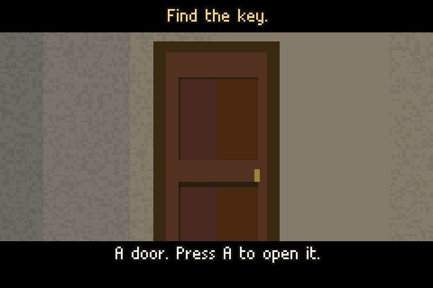

A game is a folder: its C code, its content as Python, and four lines of `game.mk`. The engine includes no header of a game; a game includes one of the engine's, [`engine/src/game_api.h`](engine/src/game_api.h), and defines nine hooks (how to draw a frame, what a script's "enemy" operation means, whether a save is valid...).

[`examples/minimal`](examples/minimal) is the smallest complete one: a lit room, a closet behind a door, a key. One 180-line C file, nine short content modules.

```sh
make GAME=examples/minimal assets all      # -> build/minimal/minimal.gba
```

```c
int main(void) {
    engine_init();
    load_level(0);
    for (;;) {
        engine_frame_start();
        for (int n = engine_ticks(); n > 0; n--) update();   // input, movement, scripts
        engine_frame();                                      // draw, govern detail, show
    }
}
```

[docs/MAKING_A_GAME.md](docs/MAKING_A_GAME.md) has the rest: what each content module must export, floor plans, every script operation, models, and the limits. Hollowmere itself, in [`game/`](game), is the full-size example. Both are MIT: copy freely.

---

## Tested, and plain about its limits

A headless [mGBA](https://mgba.io) harness scripts input, reads and writes memory by symbol, takes screenshots and fails on any bad memory access. On it, `make check` runs:

| | |
|---|---|
| Playthrough | the whole game from power-on to the ending, asserting progress at every stage, also with a death in every chapter |
| Regression tests | 38, one per bug fixed; 36 of them fail on v1.0 |
| View sweep | every place the player can stand, 20,368 views at three detail levels: no pixel left undrawn |
| Hostile saves | 43 save files (blank, random, cut off mid-write, valid checksum with nonsense inside, a real v1.0 save): each must end in a running game |
| Content limits | 47 kinds of bad content (a 41st door, a 129th vertex, a wall standing free...) each refused by the asset tools in one line |
| Stack, frame rate, boot | stack headroom from a canary painted at boot, frame rate at benchmark views, the release ROM through a minute of random input |

What it does **not** promise:

- **Not every view holds 20 fps.** Of 3,396 places and headings sampled, 62 fall below 19.5 fps and 17 of those stay at 15 fps at the lowest detail level: close views of the hall staircase and the chapel's pews, where furniture covers the screen several times over. Three quarters of all views run at full detail.
- **Nothing has been run on a console.** Every timing is from the mGBA emulator (0.10.2), which may read video memory faster than real hardware does.
- The engine's limits (40 doors and 160 props a level, 128 vertices a model, 8 scripts at once...) are in one file, [`engine/src/limits.h`](engine/src/limits.h), which the C code, the tools and the linker script all read.

Details in [docs/TOOLS.md](docs/TOOLS.md).

---

## Building

You need an ARM GCC toolchain and Python 3 with NumPy, Pillow and SciPy:

```sh
sudo apt install gcc-arm-none-eabi libnewlib-arm-none-eabi     # Debian/Ubuntu
pip install -r requirements.txt
make assets   # generate gen/ from game/content (about two minutes the first time, cached after)
make          # build hollowmere.gba
```

The build is reproducible: with the versions pinned in `requirements.txt` and listed in [docs/TOOLS.md](docs/TOOLS.md), a clean build of v1.1 produces a ROM with SHA-256
`792b0c6cab5545d648aa85ae23b0cacc8f746e633c19ac1f64942c47e005bcde`.

To run the tests as well, install `libmgba-dev`:

```sh
make check                                          # everything; about an hour (the full view sweep)
make test-rom harness && python3 engine/tools/check.py --quick      # ten minutes: the sweep on every 12th view
```

Re-rendering the Night Sister (`python3 game/content/sister/make.py`) needs Numba (`requirements-optional.txt`).

## Repository layout

```
engine/
  src/        the runtime: renderer, 3D objects, lighting, audio, effects, world, scripting VM, HUD, saves,
              the frame loop; game_api.h is its whole interface to a game, limits.h its limits
  tools/      the toolchain: asset compiler, level/mesh/script compilers, checks, benchmarks
  harness/    headless mGBA test runner
game/         Hollowmere
  src/        its code: play loop, game rules, the player, the Night Sister, the map screen, menus
  content/    its content as code: levels, models, textures, sprites, sounds, music, story
  assets/     pre-rendered frames of the Night Sister (slow to regenerate), the title font
  tests/      the playthrough, regression tests, hostile saves, benchmark views
examples/
  minimal/    the smallest game the engine builds: one C file, a room, a door, a key
docs/         architecture, content and tooling guides
CHANGELOG.md  what changed between releases
```

## License

Everything in this repository is released under the [MIT License](LICENSE): the engine, the toolchain, the documentation, and the game itself — Hollowmere's code, levels, story, models, textures, sounds, music and characters, and the screenshots in `docs/media/`. Use the engine for your own GBA games, and take whatever is useful from the game.

The title screen is set in TeX Gyre Bonum, which ships in `game/assets/fonts` under the GUST Font License.

## Credits

Hollowmere and the Hollowmere Engine were directed by [PowerBeef](https://github.com/PowerBeef) and designed, programmed and generated by Claude (Anthropic). The test harness uses [mGBA](https://mgba.io) by endrift and contributors.
