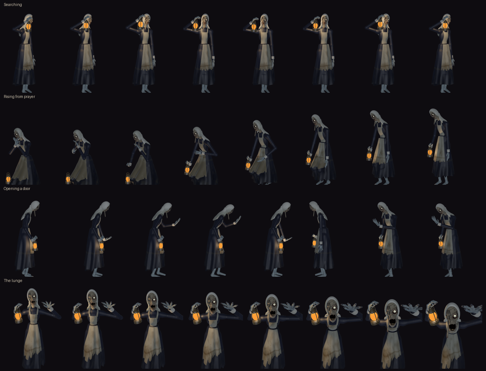

**Hollowmere v1.2**: the Night Sister moves.

**Download `Hollowmere-v1.2.zip`** below. It holds `Hollowmere.gba`: play it in [mGBA](https://mgba.io) or another accurate emulator, or on a GBA with a flash cartridge (it saves to SRAM). Best played in the dark, with headphones. Saves from v1.1 and v1.0 work.

She had walk and run cycles and four still poses. The stills are now animations: 360 pre-rendered frames where there were 155, from the same 3D rig as the rest of her.

- **She breathes.** Standing on her rounds she was one frozen picture; she now plays a six-picture loop, her shoulders and lantern rising and settling.
- **She looks for you.** Searching a room she turns her shoulders, head and lantern from side to side over eight pictures.
- **She prays, and gets up.** Kneeling in the chapel she rocks slowly. When she stirs she takes up her lantern and rises through six pictures, then kneels again the same way. She used to snap between kneeling and standing.
- **She opens doors by hand.** Her free hand goes out to a door as it swings, in step with the door.
- **The lunge that ends a chase has eight pictures**, not three.

Nothing else changes: her behaviour, the levels and the saves are those of v1.1.1. The ROM grows from 14.8 to 17.2 MB of the cartridge's 32. The known limits are unchanged: a few close views of the hall staircase and the chapel's pews run at 15 fps, and nothing has been run on a console.

Building it yourself: see the README. A clean build of this tag reproduces the ROM bit for bit (SHA-256 `120a7e71e8656f739733f0ab8a00c53024b02b5b2a0c242be669c3aecabec682`).
