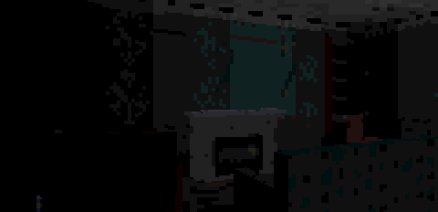

**Hollowmere v1.3**: fire.

**Download `Hollowmere-v1.3.zip`** below. It holds `Hollowmere.gba`: play it in [mGBA](https://mgba.io) or another accurate emulator, or on a GBA with a flash cartridge (it saves to SRAM). Best played in the dark, with headphones. Saves from v1.2 and earlier work.

The fireplaces used to be painted embers with a faint flicker. They are hearths now, laid and cold until you light them.

- **Light a fire.** Find the box of matches (on the kitchen stove; upstairs, on the Night Sister's dresser). A at a hearth lights it: flames, a warm light that fills the room, the crackle of the logs. A again rakes it out.
- **She cannot leave a fire burning.** She comes to it from wherever she is, kneels until it is cold, gets up and searches the room. The housekeeper's ledger warns you, in one new line.
- **So it is a tool, and a risk.** A lit room saves your battery, and she sees you sooner in it. A fire at one end of the house buys you the other end, and it calls her when she was not there at all. What she has put out will not light again.
- **Six hearths**: three downstairs, and three new ones upstairs, in the two wards and the doctor's bedroom. No wall or door moved.
- **Fixed**: upstairs she could come back on her rounds shut inside the doctor's locked suite, and stay there.

Also fixed: switching the flashlight could still cost a frame at some moments in the heaviest view.

Everything else is v1.2. The known limits stand: a few close views of the hall staircase and the chapel's pews run at 15 fps (18 of 3,381 sampled, one more than before: a corner of the west ward), the views of the new hearths upstairs run at a lower detail level than the bare walls they replaced, and nothing has been run on a console.

Building it yourself: see the README. A clean build of this tag reproduces the ROM bit for bit (SHA-256 `323abdde7c14d530b576c5bd726bf953f5a1c97a2ea39f563ce578814e2b52e8`).
